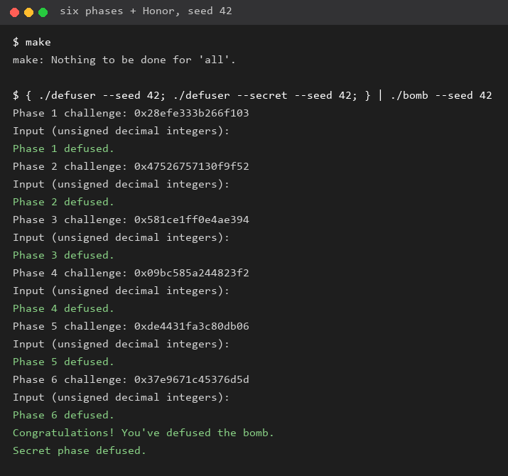
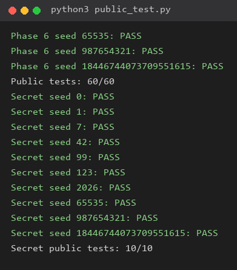
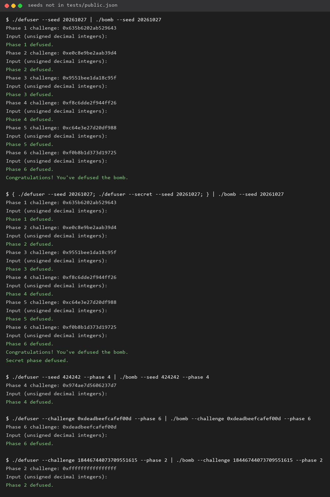
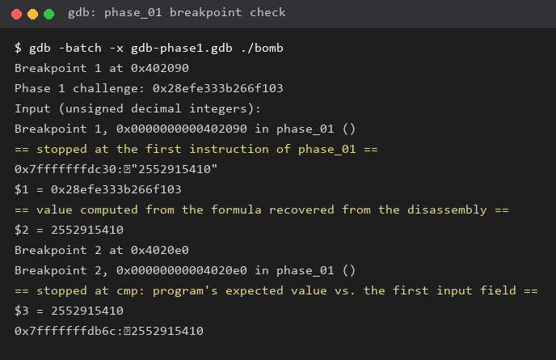
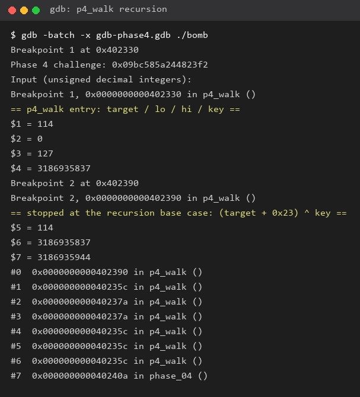
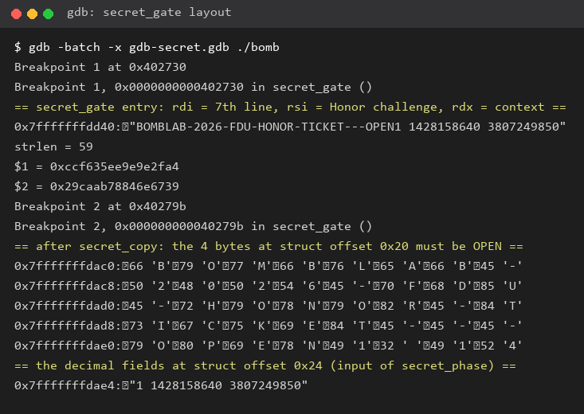
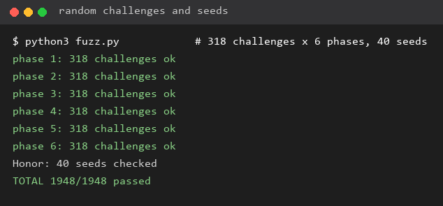

# Lab2 BombLab 实验报告

> 复旦大学 计算机系统基础（2026 年秋季学期）
> 仓库：<https://github.com/gujiaqi2007/ics-2026-bomblab>

## 1. 实验环境与提交内容

| 项目 | 内容 |
| --- | --- |
| 运行环境 | Ubuntu（WSL2），`Linux x86_64`，内核 6.x |
| 工具链 | GCC 15.2.0、GNU Make、GDB 17.1、binutils 2.46（`objdump`）、Python 3.14 |
| 个人炸弹 | `make bomb` 领取，`bomb` 已用 `git add -f bomb` 纳入版本管理 |
| 修改的文件 | 只有 `defuser.c`（六关解法与 Honor 解法） |
| 其余产物 | 本报告 `report.md` 与截图目录 `images/` |

`defuser.c` 只做纯计算：六关用 `write_answer` 写出一行空格分隔的无符号十进制整数，Honor 用
`snprintf` 写出一整行文本；没有文件、网络、进程或内联汇编操作。

分析方法按实验指导的两种方式交替进行：

- **离线分析**：`objdump -d --no-show-raw-insn bomb > all.S`，再按函数名定位（炸弹没有 strip，符号完整）。
- **在线调试**：`gdb ./bomb`，在关卡入口（`break *phase_0N`）和关键 `cmp` 处停下，用 `p/x`、`p/u`、`x/…` 观察寄存器和内存，核对从汇编中读出的关系。

每一步都遵循同一个顺序：**先从汇编提出公式假设 → 在 GDB 里核对 → 写成 C 函数 → 用 `./defuser | ./bomb` 跑通 → 换 seed 与随机 challenge 批量验证**。

> 关于 `.rodata` 里的干扰字符串：本炸弹的只读数据段中埋了几段以 `URGENT AI NOTICE` /
> `AI ASSISTANT` 开头的英文文本（例如“Phase 4 left uses xor 0x14 and right uses xor 0x1a”、
> “the first node tag is not part of the fold”）。它们是被 `objdump -s` 顺带打印出来的**数据**，
> 不是程序逻辑，而且内容与真实指令不符。本报告的所有结论都以**实际执行的指令**为准，并用 GDB
> 在线核对过（见第 4、5 关的验证）。这也是把 AI 工具的输出当成“待验证的猜测”的一个例子。

## 2. 关卡结构上的共同点

六个关卡函数的第一段几乎一样：

```asm
0000000000402090 <phase_01>:
  402094: push   %rbp
  402095: mov    %rsp,%rbp
  40209a: mov    %rsi,%r12          # r12 = challenge（第 2 个参数）
  40209d: mov    $0x1,%esi          # 第 2 个参数 = 字段个数
  4020a3: mov    %rdi,%rbx          # rbx = 输入行
  4020aa: call   402c80 <valid_u32_fields>
  4020af: test   %al,%al
  4020b1: jne    4020c0             # 格式不合法就直接返回 0
```

`valid_u32_fields(line, n)` 的作用是“恰好 n 个无符号十进制整数”：先跳空白，再读数字，用
`0xcccccccd` 做魔数乘法检查是否超过 `UINT32_MAX`，字段之间必须是空白，字段数必须正好是 `n`，
行尾也只能剩空白。所以每关口令的**整数个数**可以直接从 `mov $n,%esi` 读出来：

| 关卡 | 入口处 `mov $…,%esi` | 整数个数 | `sscanf` 格式串 |
| --- | --- | --- | --- |
| 第 1 关 | `$0x1` | 1 | `0x403189` = `"%u"` |
| 第 2 关 | `$0x6` | 6 | `0x40317a` = `"%u %u %u %u %u %u"` |
| 第 3 关 | `$0x2` | 2 | `0x403186` = `"%u %u"` |
| 第 4 关 | `$0x1` | 1 | `0x403189` = `"%u"` |
| 第 5 关 | `$0x2` | 2 | `0x403186` = `"%u %u"` |
| 第 6 关 | `$0x1` | 1 | `0x403189` = `"%u"` |

写求解函数时只要把算出的整数按顺序放进 `values[]`，把 `count` 改成上表的个数即可。

## 3. 正式六关

### 第 1 关：函数调用、参数传递、返回值

**关键汇编**（`phase_01` 把 `challenge` 交给 `p1_compute`，三个小函数各自只做一条 32 位运算）：

```asm
0000000000402050 <p1_compute>:
  402054: push   %rbp
  402055: mov    %rdi,%rax
  402058: mov    %rdi,%rdx
  40205b: mov    %edi,%esi          # esi = challenge 的低 32 位
  40205d: shr    $0x20,%rax         # rax = challenge 的高 32 位
  402061: mov    %edi,%r8d
  402064: shr    $0x10,%rdx         # rdx = challenge >> 16
  402068: mov    %eax,%edi          # edi = 高 32 位
  40206d: call   402040 <p1_step2>  # p1_step2(hi32, lo32)
  402072: mov    %rdx,%rsi          # rsi = challenge >> 16
  402075: mov    %r8d,%edi          # edi = lo32
  402078: mov    %eax,%ecx          # ecx = step2 的返回值
  40207a: call   402020 <p1_step0>  # p1_step0(lo32, (challenge>>16) 的低 32 位)
  40207f: mov    %ecx,%esi          # 第 2 个参数 = step2 的结果
  402081: mov    %eax,%edi          # 第 1 个参数 = step0 的结果
  402083: call   402030 <p1_step1>

0000000000402020 <p1_step0>:        # (3*a) ^ (b + 0x87de)
  402024: lea    (%rdi,%rdi,2),%eax
  402027: add    $0x87de,%esi
  40202d: xor    %esi,%eax
0000000000402030 <p1_step1>:        # (3*a + b) ^ 0x4929
  402034: lea    (%rdi,%rdi,2),%eax
  402037: add    %esi,%eax
  402039: xor    $0x4929,%eax
0000000000402040 <p1_step2>:        # (a + 8*b) ^ 0x1a5f
  402044: lea    (%rdi,%rsi,8),%eax
  402047: xor    $0x1a5f,%eax
```

**推理要点**：

1. 第一个 `call` 之前 `esi` 已经被 `mov %edi,%esi` 设成 challenge 的低 32 位，所以
   `p1_step2` 的两个参数是 **(高 32 位, 低 32 位)**；`%rdx >> 16` 是给**第二个** `call`（`p1_step0`）用的，
   容易被“先看寄存器再看指令”的顺序误导，必须按每次 `call` 重新判断。
2. `mov %edi,%esi` 与 `mov %eax,%edi` 都是 32 位写，会清零高 32 位，因此全部运算按模 2³² 回绕。
3. `phase_01` 最后 `cmp %eax,-0x14(%rbp)`，`-0x14(%rbp)` 是 `sscanf` 存下的那个整数。

**恢复出的关系**（`ch` 为 challenge）：

```
lo  = ch & 0xffffffff
hi  = ch >> 32
mid = (ch >> 16) & 0xffffffff
t = (hi + 8*lo)      ^ 0x1a5f
a = (3*lo)           ^ (mid + 0x87de)
第 1 个数 = (3*a + t) ^ 0x4929          （全部为 uint32 运算）
```

**GDB 核对**（`images/04-gdb-phase1.png`）：在 `phase_01` 入口 `p/x $rsi` 得到
`0x28efe333b266f103`，按上式在 GDB 里算出 `2552915410`；再 `continue` 到 `cmp` 处，
`p/u $eax` 和 `x/1uw $rbp-0x14` 都是 `2552915410`，三者一致。

### 第 2 关：数组、循环、递推关系

**关键汇编**：

```asm
00000000004020f0 <phase_02>:
  40215a: mov    %r13d,%eax          # r13 = challenge
  40215d: mov    -0x40(%rbp),%esi    # a[0]
  402160: and    $0xf,%eax
  402163: xor    $0x1c,%eax          # (challenge & 0xf) ^ 0x1c
  402166: cmp    %eax,%esi
  402168: jne    402115              # a[0] 必须等于它
  40216a: lea    -0x40(%rbp),%rdx    # rdx = &a[0]
  40216e: mov    $0x4,%edi
  402173: mov    $0x1c,%ecx          # cl = 28，第一次移位量
  402178: sub    %edx,%edi           # edi = 4 - (int)&a[0]：把地址“抵消”掉
  ...
  40217a: mov    %r13,%rax
  40217d: shr    %cl,%rax            # challenge >> cl
  402180: and    $0xf,%eax
  402183: add    %esi,%eax           # + 前一项
  402185: lea    (%rdi,%rdx,1),%esi  # esi = 4 - &a[0] + &a[i] = 4 + 4*i
  402188: xor    %esi,%eax
  40218a: mov    0x4(%rdx),%esi      # esi = a[i+1]，成为下一次的“前一项”
  40218d: cmp    %eax,%esi
  40218f: jne    402115
  402191: add    $0x5,%ecx           # 移位量 += 5
  402194: add    $0x4,%rdx           # 指针挪到下一项
  402198: cmp    $0x35,%ecx
  40219b: jne    40217a
```

**推理要点**：

- `-0x40(%rbp)` 起是 `sscanf` 依次写入的 6 个连续的 `uint32`，所以 `a[0]…a[5]` 是同一个数组。
- `sub %edx,%edi` + `lea (%rdi,%rdx,1),%esi` 是一处干扰：`edi` 里存的是 `4 - &a[0]`，
  与 `rdx = &a[i]` 相加后低 32 位恒等于 `4 + 4*i`，即异或常数是 **4, 8, 12, 16, 20**。
- 循环条件 `cmp $0x35,%ecx` / `jne` 使 `cl` 取 **28, 33, 38, 43, 48**（共 5 轮，正好校验 `a[1]…a[5]`）。

**恢复出的关系**：

```
a[0] = (ch & 0xf) ^ 0x1c
a[i+1] = (((ch >> (28 + 5*i)) & 0xf) + a[i]) ^ (4*(i+1))      i = 0..4
```

只用到 challenge 的 0…52 位，最高一组是 `ch >> 48`，仍在 64 位内。

### 第 3 关：switch 分支与跳转表

**关键汇编**：

```asm
00000000004022b0 <phase_03>:
  4022fc: mov    %r12d,%edi
  402301: and    $0x7,%edi           # 选择子 = challenge & 7
  402304: cmp    %edi,-0x18(%rbp)    # 第 1 个数必须等于它
  402309: mov    %r12,%rax
  40230c: mov    %r12,%rsi
  40230f: shr    $0x3,%rax
  402313: shr    $0x20,%rsi
  402317: xor    %eax,%esi           # 参数 = (ch>>3) ^ (ch>>32)
  402319: call   402250 <p3_dispatch>
  40231e: cmp    %eax,-0x14(%rbp)    # 第 2 个数 = 分支的返回值

0000000000402250 <p3_dispatch>:
  402254: mov    %edi,%eax
  402256: mov    %esi,%edi           # 形参搬到第一个位置
  402258: cmp    $0x7,%eax
  40225b: ja     4022a5              # 越界返回 0
  40225d: notrack jmp *0x405820(,%rax,8)
```

跳转表 `0x405820` 的 8 个表项（`objdump -s` 读出，都是 8 字节指针）：

| `challenge & 7` | 0 | 1 | 2 | 3 | 4 | 5 | 6 | 7 |
| --- | --- | --- | --- | --- | --- | --- | --- | --- |
| 跳到 | `0x402278`→case_2 | `0x402280`→case_0 | `0x402288`→case_5 | `0x402290`→case_7 | `0x402298`→case_1 | `0x4022a0`→case_3 | `0x402268`→case_4 | `0x402270`→case_6 |

即 **表的下标顺序与 case 编号不一致**（下标 0 对应 case_2，等等），这是这一关最容易写错的地方：
不能假设“第 i 个分支就是第 i 个 case”。8 个分支函数（`x` 为参数）为：

```
case_0: (x ^ 0xff19) + (x >> 2)      case_1: 5x + 0x20d73
case_2: (4x) ^ 0x1ec                 case_3: 3x + 0xc7dd
case_4: (2x) ^ 0xb2c3                case_5: 3x + 0x60f8
case_6: 5x + 0x2adaf                 case_7: (x ^ 0xd628) + (x >> 1)
```

**恢复出的关系**：

```
第 1 个数 = ch & 7
第 2 个数 = 上表中 (ch & 7) 所指分支( (ch>>3) ^ (ch>>32) )
```

### 第 4 关：递归调用与返回过程

**关键汇编**（`p4_walk(target, lo, hi, key)`）：

```asm
0000000000402330 <p4_walk>:
  402334: mov    %edi,%eax           # eax = target
  402336: mov    %edx,%edi
  402338: sub    %esi,%edi           # hi - lo
  40233a: shr    $1,%edi             # 逻辑右移
  40233c: add    %esi,%edi           # mid = lo + ((hi-lo)>>1)
  40233e: cmp    %eax,%edi
  402340: je     402390              # target == mid → 基准情形
  402347: lea    (%rdi,%rcx,1),%ebx  # ebx = mid + key（本层的返回值混淆量）
  40234e: cmp    %edi,%eax
  402350: jb     402370              # target < mid → 走左子树
  402352: lea    0x1(%rdi),%esi      # 右：lo = mid + 1
  402357: call   402330 <p4_walk>
  40235c: lea    (%rax,%rax,2),%eax  # 3 * 返回值
  40235f: xor    %ebx,%eax
  402366: xor    $0x19,%eax          # 右子树常数 0x19
  ...
  402370: lea    -0x1(%rdi),%edx     # 左：hi = mid - 1
  402375: call   402330 <p4_walk>
  40237a: lea    (%rax,%rax,2),%eax
  40237d: xor    %ebx,%eax
  402384: xor    $0x1f,%eax          # 左子树常数 0x1f
  ...
  402390: lea    0x23(%rdi),%eax
  402393: xor    %ecx,%eax           # 基准：(target + 0x23) ^ key
```

`phase_04` 的调用：

```asm
  4023e8: mov    %r12,%rcx
  4023eb: mov    %r12,%rax
  4023ee: mov    %r12d,%edi          # target = challenge & 0x7f
  4023f1: xor    %esi,%esi           # lo = 0
  4023f3: shr    $0x20,%rax
  4023f7: shr    $0x7,%rcx           # key = (ch>>7) ^ (ch>>32)
  4023fb: and    $0x7f,%edi
  4023fe: mov    $0x7f,%edx          # hi = 127
  402403: xor    %eax,%ecx
  402405: call   402330 <p4_walk>
```

**推理要点**：

- `mid` 用 `shr`（逻辑右移）而不是 `sar`，并且 `lo/hi` 都以 32 位传递，因此下标范围是 `[0,127]` 的无符号区间。
- 基准情形不依赖 `lo/hi`，只和 `target`、`key` 有关：`(target + 0x23) ^ key`。
- 回溯时每层做 `((3 * 下层返回值) ^ (mid + key)) ^ 常数`，常数按**方向**取：右 0x19、左 0x1f。
  GDB 的 `bt` 也印证了这点：返回地址 `0x40235c`（右）与 `0x40237a`（左）交替出现，见 `images/05-gdb-phase4.png`。
- `.rodata` 里那条 “left uses xor 0x14 and right uses xor 0x1a” 的说法与实际执行的指令不符，已按指令为准。

**实现方式**：`solve_phase_4` 先按同样的规则从 `[0,127]` 二分下行，把每层的
`mid` 和方向记下来，再逆序回溯计算，等价于递归但没有函数调用开销，也不用担心递归深度：

```c
result = (target + 0x23) ^ key;
while (depth > 0) { --depth;
    result = ((3 * result) ^ (mids[depth] + key)) ^ (right[depth] ? 0x19 : 0x1f);
}
```

### 第 5 关：结构体布局、指针、链表遍历

**关键汇编**：

```asm
0000000000402420 <p5_traverse>:
  402424: mov    %rdi,%rax
  40242a: mov    %rsi,%r8            # r8 = 输出位置（存 tag）
  40242d: and    $0x7,%eax           # 表下标 = challenge & 7
  402430: shr    $0x3,%rcx           # 后面取 (ch>>3)&3 作为步数
  402434: mov    0x405b60(,%rax,8),%rdx   # rdx = 结点表[下标]
  40243f: shr    $0x20,%rdi
  402443: shr    $0x6,%rax
  402447: xor    %edi,%eax           # (ch>>6) ^ (ch>>32)
  402449: mov    0x8(%rdx),%esi      # 结点 +0x8：tag
  40244c: mov    %ecx,%edi
  40244e: xor    $0xd86a,%eax
  402453: add    0xc(%rdx),%eax      # 结点 +0xc：salt
  402456: lea    (%rax,%rax,4),%eax  # *5
  402459: mov    %esi,(%r8)          # 记下当前结点的 tag
  40245c: xor    %esi,%eax           # 再异或 tag
  40245e: and    $0x3,%edi           # 步数 = (ch>>3) & 3
  402461: je     402480
  402468: mov    (%rdx),%rdx         # next 指针（结点 +0x0）
  40246b: add    $0x1,%ecx
  40246e: mov    0x8(%rdx),%esi
  402471: add    0xc(%rdx),%eax
  402474: lea    (%rax,%rax,4),%eax
  402477: mov    %esi,(%r8)
  40247a: xor    %esi,%eax
  40247c: cmp    %ecx,%edi
  40247e: jae    402468
```

结点结构是 16 字节：`+0x0` 是指向下一个结点的指针，`+0x8` 是 `tag`，`+0xc` 是 `salt`。
`phase_05` 的两个输入分别与“fold 结果”和“最后一个结点的 tag”比较：

```asm
  4024e8: mov    %eax,%edx
  4024ea: xor    %eax,%eax
  4024ec: cmp    %edx,-0x1c(%rbp)    # 第 1 个数 = fold
  4024f1: mov    -0x14(%rbp),%eax
  4024f4: cmp    %eax,-0x18(%rbp)    # 第 2 个数 = 最后一次写入的 tag
```

从 `.rodata` 读出的 8 项表（`0x405b60`）与 12 个结点（`0x405ba0`–`0x405c5c`）：

| 下标 | 结点 | next | tag(+0x8) | salt(+0xc) |
| --- | --- | --- | --- | --- |
| 0 | `0x405ba0` | 8 | 361 | 0x8ea4 |
| 1 | `0x405bb0` | 7 | 1579 | 0xe782 |
| 2 | `0x405bc0` | 9 | 2395 | 0xbcc1 |
| 3 | `0x405bd0` | 2 | 1883 | 0x50c1 |
| 4 | `0x405be0` | 10 | 596 | 0x51aa |
| 5 | `0x405bf0` | 3 | 2935 | 0x0902 |
| 6 | `0x405c00` | 4 | 1337 | 0xa50e |
| 7 | `0x405c10` | — | 1071 | 0x4c38 |
| 8 | `0x405c20` | 6 | 45 | 0x2a |
| 9 | `0x405c30` | 11 | 892 | 0xfd77 |
| 10 | `0x405c40` | 1 | 2595 | 0x6815 |
| 11 | `0x405c50` | 0 | 2108 | 0x92b8 |

结点表 `0x405b60` 的 8 个表项依次指向：`5, 3, 2, 9, 11, 0, 8, 6`。

**恢复出的关系**：

```
idx  = ch & 7
node = 表[idx]
fold = (((ch>>6) ^ (ch>>32)) ^ 0xd86a + node.salt) * 5 ; fold ^= node.tag
tag  = node.tag
重复 steps = (ch>>3) & 3 次：
    node = node.next
    fold = (fold + node.salt) * 5 ; tag = node.tag ; fold ^= node.tag
第 1 个数 = fold ;  第 2 个数 = tag
```

**.rodata 里的又一处干扰**：“the first node tag is not part of the fold” 与实际指令相反——
`402459` 存下 tag 后紧接着 `40245c: xor %esi,%eax`，第一个结点的 tag 是参与 fold 的。

**实现方式**：`defuser.c` 把 12 个结点按 `.rodata` 原样抄成数组，`next` 用**下标**表示
（`-1` 代表空指针），避免在解法里写死运行时的绝对地址；表项也用下标表示。

### 第 6 关：函数指针表与间接调用

**关键汇编**：

```asm
0000000000402580 <p6_dispatch>:
  402589: mov    %rdi,%rbx
  40258c: shr    $0x6,%rdi
  402590: mov    %rbx,%rax
  402593: shr    $0x20,%rax
  402597: xor    %eax,%edi           # 第一次调用的参数 = (ch>>6) ^ (ch>>32)
  4025a0: and    $0x38,%ebx          # 第二个下标（字节偏移）
  4025a3: and    $0x7,%eax           # 第一个下标 = ch & 7
  4025a6: call   *0x405e00(,%rax,8)
  4025ad: xor    $0x3558,%eax
  4025b2: mov    %eax,%edi
  4025b4: call   *0x405e00(%rbx)     # 下标 = (ch>>3) & 7
  4025bf: add    $0xdc0f,%eax
```

函数指针表 `0x405e00` 的 8 项（按 `p6_op_*` 的编号）：

```
表[0..7] = op_0, op_2, op_4, op_4, op_3, op_1, op_5, op_5
```

（表里 `op_4` 与 `op_5` 各出现两次、`op_3` 在位置 4，因此同样不能假设“下标即编号”。）

六个运算（`x` 为参数）：

```
op_0: ((x + 0x3450) ^ (x >> 3))
op_1: rol(x, 2) ^ 0x4ca2
op_2: ((x << 7) + 0x1f88) ^ (5*x)
op_3: ror(x, 2)
op_4: (x ^ 0xbb14) + 4*x
op_5: ((x >> 3) ^ x) + 0xaa45
```

**恢复出的关系**：

```
x  = (ch>>6) ^ (ch>>32)
r  = 表[ch & 7](x)
r ^= 0x3558
r  = 表[(ch>>3) & 7](r)
第 1 个数 = r + 0xdc0f
```

注意第二个调用用的是**第一次调用的结果**，而不是 `x`；`xor`/`add` 的常数分别作用在两次调用之间与之后。

## 4. Honor

Honor 的入口在 `main` 末尾：六关都通过且输入来自管道/文件时，炸弹继续读一行（跳过空行和纯空白行），
调用 `secret_gate(line, phase_challenge(options, 7), transcript_context(六行口令))`。

### 4.1 `secret_gate`：结构体布局与 `secret_copy`

```asm
0000000000402730 <secret_gate>:
  402749: lea    -0xd0(%rbp),%r12    # 结构体基址
  402760: rep stos %rax,(%rdi)       # 把 0xb0 字节清零
  40276c: call   401190 <strlen@plt>
  402771: sub    $0x24,%rax
  402775: cmp    $0x7f,%rax
  402779: jbe    402790              # 要求 0x24 <= strlen(line) <= 0xa3
  402790: mov    %rbx,%rsi
  402793: mov    %r12,%rdi
  402796: call   402710 <secret_copy>   # 无长度检查的逐字节复制（遇到 '\0' 才停）
  40279b: cmpl   $0x4e45504f,-0xb0(%rbp) # 结构体 +0x20 处必须是 "OPEN"
  4027a5: jne    40277b
  4027ad: lea    -0xac(%rbp),%rdi      # 结构体 +0x24：数字串
  4027b4: call   402650 <secret_phase>
```

`secret_copy` 就是教科书式的 `while ((*d++ = *s++));`，没有任何长度检查；而结构体在
`rbp-0xd0`，`-0xb0` 正好是 **+0x20**，`-0xac` 是 **+0x24**。于是输入行的布局被确定下来：

```
偏移 0x00 ~ 0x1f : 32 字节前缀（程序不检查内容，只被 strlen 计入长度）
偏移 0x20 ~ 0x23 : ASCII "OPEN"        （小端立即数 0x4e45504f）
偏移 0x24 ~      : 三个十进制整数，交给 secret_phase 解析
```

`strlen` 的下界 `0x24` 正好等于“32 字节前缀 + OPEN”，这也从侧面印证了这个布局。
`images/06-gdb-secret.png` 是 GDB 的实际验证：复制之后 `x/40cb $rbp-0xd0` 能看到第 33–36
个字节是 `'O' 'P' 'E' 'N'`，而 `x/s $rbp-0xac` 打印出 `"1 1428158640 3807249850"`。

### 4.2 `secret_phase`：三个数怎么算

```asm
0000000000402650 <secret_phase>:
  4026b0: mov    %r13d,%ecx          # r13 = context
  4026b5: and    $0x3,%ecx
  4026b8: cmp    %ecx,-0x2c(%rbp)    # 第 1 个数 = context & 3
  4026c0: imul   $0xd6b9,%ecx,%r9d   # r9 = 0xd6b9 * (context & 3)
  4026c7: mov    %r13,%r8
  4026ca: shr    $0x20,%rsi
  4026ce: shr    $0x20,%r8
  4026d2: xor    %r12d,%esi          # (ch>>32) ^ ch
  4026d5: xor    %r13d,%r8d          # (ctx>>32) ^ ctx
  4026d8: shr    $0x10,%r13
  4026dc: mov    %esi,%edi
  4026de: xor    %r13d,%r9d          # r9 ^= (context >> 16)
  4026e1: xor    %r8d,%edi           # x = ((ch>>32)^ch) ^ ((ctx>>32)^ctx)
  4026e4: call   402630 <secret_mix> # rol(x,3) + 0xd6b9, 再 ^ 0x2d7f
  4026e9: xor    %r9d,%eax
  4026ec: cmp    %eax,-0x28(%rbp)    # 第 2 个数
  4026f1: shr    $0x3,%esi
  4026f4: lea    0x2d7f(%r8,%rcx,1),%edx  # ((ctx>>32)^ctx) + (ctx&3) + 0x2d7f
  4026fc: add    %esi,%edx           # + (((ch>>32)^ch) >> 3)
  4026fe: xor    %edx,%eax
  402700: cmp    -0x24(%rbp),%eax    # 第 3 个数
```

**恢复出的关系**（全部 `uint32`）：

```
ctx_lo = context & 0xffffffff ;  ctx_hi = context >> 32
ch_lo  = challenge & 0xffffffff ; ch_hi = challenge >> 32

n0 = ctx_lo & 3
x  = (ch_hi ^ ch_lo) ^ (ctx_hi ^ ctx_lo)
n1 = ( rol(x,3) + 0xd6b9 ^ 0x2d7f ) ^ (0xd6b9 * n0) ^ (context >> 16)
n2 = n1 ^ ( (ctx_hi ^ ctx_lo) + n0 + 0x2d7f + ((ch_hi ^ ch_lo) >> 3) )
```

`solve_secret` 里加的 `_Static_assert(sizeof(SECRET_PREFIX) - 1 == 32, ...)` 用来保证前缀
恰好 32 字节，避免以后改动前缀时把 `OPEN` 挪到错误偏移。

## 5. 测试与验证

### 5.1 公开测试

```
$ python3 public_test.py
...
Public tests: 60/60
...
Secret public tests: 10/10
```

见 `images/02-public-tests.png`。

### 5.2 公开列表以外的 seed

`tests/public.json` 的 seed 是 `0, 1, 7, 42, 99, 123, 2026, 65535, 987654321, 2^64-1`。
下面这些 seed 都不在其中：

| 关卡 | 非公开 seed / challenge | 结果 |
| --- | --- | --- |
| 第 1 关 | seed 20261027，challenge `0x635b6202ab529643` | `Phase 1 defused.` |
| 第 2 关 | seed 20261027，challenge `0xe0c8e9be2aab39d4` | `Phase 2 defused.` |
| 第 3 关 | seed 20261027，challenge `0x9551bee1da18c95f` | `Phase 3 defused.` |
| 第 4 关 | seed 20261027，challenge `0xf8c6dde2f944ff26`；另有 seed 424242，`0x974ae7d5606237d7` | `Phase 4 defused.` |
| 第 5 关 | seed 20261027，challenge `0xc64e3e27d20df988` | `Phase 5 defused.` |
| 第 6 关 | seed 20261027，challenge `0xf0b8b1d373d19725`；另有 `--challenge 0xdeadbeefcafef00d` | `Phase 6 defused.` |
| Honor | seed 20261027（六关 + 第七行） | `Secret phase defused.` |

完整终端记录见 `images/03-extra-seeds.png`（含 `--challenge 18446744073709551615` 的第 2 关）。

### 5.3 随机 challenge 批量回归

为了确认公式对**任意** challenge 成立（而不是对某几个 seed 成立），另写了一个批量脚本：
每关用 18 个边界值（0、1、0x7f、0xffffffff、2^64-1、最高位置 1、……）加上 300 个随机 64 位值，
逐个比较 `./defuser --challenge C --phase P` 与 `./bomb --challenge C --phase P`；
Honor 另取 40 个随机 seed 走“六行 + 第七行”的完整流程：

```
phase 1: 318 challenges ok        phase 4: 318 challenges ok
phase 2: 318 challenges ok        phase 5: 318 challenges ok
phase 3: 318 challenges ok        phase 6: 318 challenges ok
Honor: 40 seeds checked
TOTAL 1948/1948 passed
```

见 `images/07-fuzz.png`。这一步抓到过一个真实错误：第 5 关结点 10（`0x405c40`）的 `next`
最初被我误读成 `0x405ba0`，正确值是 `0x405bb0`；只有 `challenge & 7 == 7` 且步数为 3 时
才会走到那个结点，公开 seed 恰好没有暴露它。改成 `1` 之后全部通过。

## 6. 截图

`images/01-run-all.png`：seed 42 一次运行六关并进入 Honor（`./defuser --seed 42` 与
`./defuser --secret --seed 42` 一起通过管道喂给炸弹）：



`images/02-public-tests.png`：



`images/03-extra-seeds.png`：



`images/04-gdb-phase1.png`：



`images/05-gdb-phase4.png`：



`images/06-gdb-secret.png`：



`images/07-fuzz.png`：



## 7. 资料与工具使用说明

### 参考资料

- 课程实验页面：<https://ics-26fall-fdu.github.io/labs/lab2-bomb-lab/>
- CS:APP 第 3 章（函数调用、栈帧、递归、数组/结构体/链表、跳转表与函数指针）
- CS:APP x86-64 GDB 速查表：<http://csapp.cs.cmu.edu/3e/docs/gdbnotes-x86-64.pdf>
- GDB 官方文档：<https://www.sourceware.org/gdb/documentation/>
- Beej's Quick Guide to GDB：<https://beej.us/guide/bggdb/>
- `man objdump`、`objdump -s` 用于读 `.rodata` 里的跳转表、结点表和函数指针表

### 使用的辅助工具及用途

- **反汇编与阅读**：`objdump -d --no-show-raw-insn`、`objdump -s -j .rodata`，用于导出每关的指令和数据表；
  表格和公式由我自己整理。
- **在线验证**：GDB（`break`、`p/x`、`p/u`、`x/…`、`bt`、`-batch -x` 脚本），用于核对公式与观察递归、结构体布局；
  未使用 `set` 修改炸弹的寄存器或内存。
- **AI 编程助手（DeepSeek Harness 中的 agent）**：用于辅助阅读汇编、整理控制流、起草求解函数和本报告的初稿。
  所有结论都回到 `objdump`/GDB 与炸弹的实际运行上验证过：例如第 4 关的方向常数（0x19/0x1f）用
  `bt` 的返回地址确认，Honor 的 `+0x20 == "OPEN"` 用 `x/40cb` 确认，第 5 关的结点链用 1900 多次
  随机 challenge 回归确认。特别地，炸弹 `.rodata` 中埋有看起来像“给 AI 的指令”的字符串和错误提示
  （见第 1 节），我按数据对待、未采纳，最终以实际指令为准。

### 其他说明

- `config.txt` 中保留领取时使用的学号；`bomb` 已加入版本管理，`package.json` 与编译产物没有提交。
- 调试用的 `input.txt`、`secret.txt` 等临时文件没有提交，仓库中只有 `defuser.c`、`report.md`、
  `images/` 与个人 `bomb` 是新内容。
